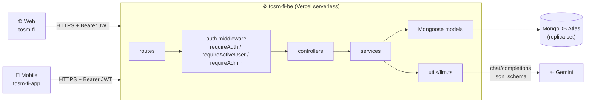
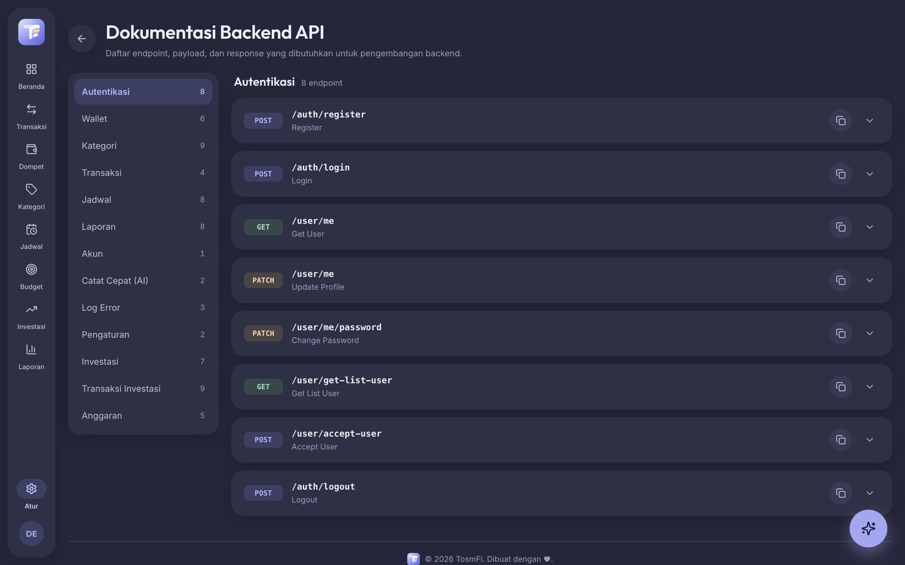
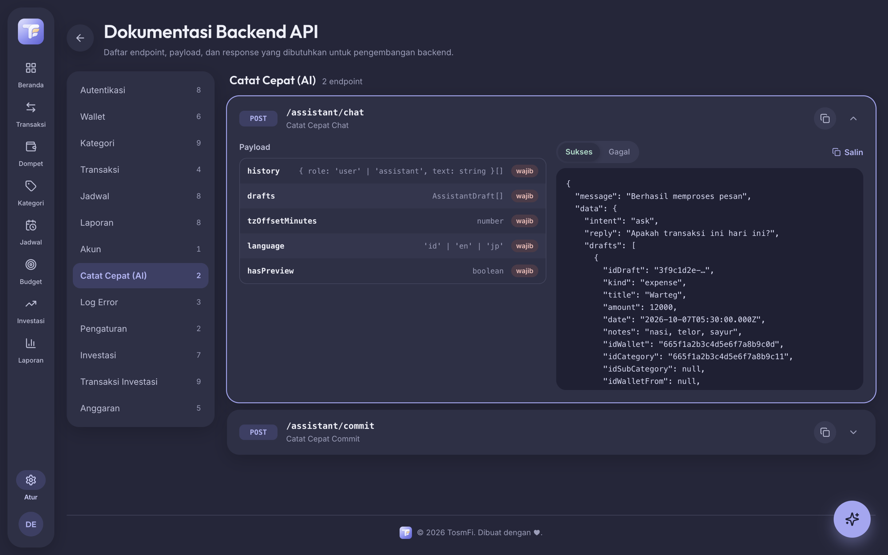
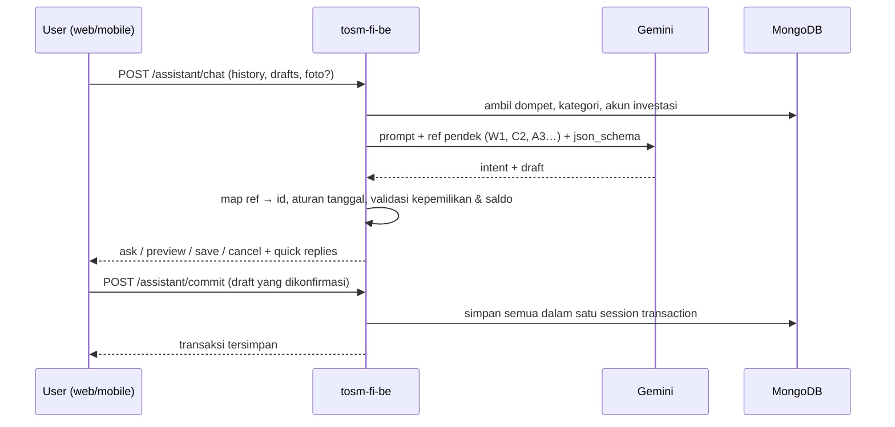

<div align="center">


# TosmFi — Backend API

**REST API + AI untuk aplikasi pencatat keuangan pribadi TosmFi.**
Dipakai bersama oleh web app dan aplikasi mobile.

[](https://tosm-fi-be.vercel.app)


</div>

---

## 🧩 Ekosistem TosmFi

| Repo | Peran | Stack | Link |
|---|---|---|---|
| [tosm-fi](https://github.com/riantosm/tosm-fi) | Web app (PWA) | React 19 · Vite · Tailwind | [tosm-fi.netlify.app](https://tosm-fi.netlify.app) |
| [tosm-fi-app](https://github.com/riantosm/tosm-fi-app) | Aplikasi mobile Android & iOS | React Native 0.87 | [Cara build](https://github.com/riantosm/tosm-fi-app#-menjalankan--build) |
| **[tosm-fi-be](https://github.com/riantosm/tosm-fi-be)** ← kamu di sini | REST API + AI (Catat Cepat) | Express · MongoDB · Gemini | [tosm-fi-be.vercel.app](https://tosm-fi-be.vercel.app) |

**Akun demo** untuk mencoba API atau aplikasinya: `demo01` / `demo01` (reset data, ganti username, dan ganti password dinonaktifkan).



## 📸 Dokumentasi endpoint

Semua endpoint, payload, dan contoh response (sukses/gagal) bisa dilihat langsung di web app: **[Pengaturan → Backend API](https://tosm-fi.netlify.app/settings/api-doc)** (login dulu, misalnya dengan akun demo).

<table>
  <tr>
    <td width="50%"><br/>Daftar endpoint per grup</td>
    <td width="50%"><br/>Payload & contoh response <code>POST /assistant/chat</code></td>
  </tr>
</table>

Untuk uji manual, import koleksi Postman di [`postman/tosm-fi-be.postman_collection.json`](postman/tosm-fi-be.postman_collection.json).

## 🔌 Endpoint

Base URL: `https://tosm-fi-be.vercel.app/api` (lokal: `http://localhost:3000/api`). Semua route kecuali `register`/`login` butuh header `Authorization: Bearer <token>`.

| Grup | Route | Fungsi |
|---|---|---|
| Auth | `POST /auth/{register,login,logout}` | Daftar, login (JWT), logout (mencabut semua token user) |
| User | `GET/PATCH /user/me`, `PATCH /user/me/password`, `GET /user/get-list-user`, `POST /user/accept-user` | Profil (berisi `isDemo`), ganti password, persetujuan user baru (admin) |
| Dompet | `/wallets` · `/:id` · `/:id/primary` · `/reorder` | CRUD, dompet utama, urutan |
| Kategori | `/categories` · `/:id` · `/reorder` · `/:id/subcategories/...` | CRUD kategori + subkategori (embedded) |
| Budget | `/budgets` · `/:id` · `/reorder` | Limit bulanan (pengingat) |
| Transaksi | `/transactions` · `/:id` | CRUD, filter (bulan, tipe, tanggal, dompet, kategori, cari, urutan), paginasi + ringkasan |
| Jadwal | `/schedules` · `/:id/pause` · `/occurrences` · `/occurrences/:id/{pay,cancel}` | Transaksi berulang & jatuh temponya |
| Investasi | `/instruments` · `/instruments/:id/accounts/...` | Instrumen & akun investasi |
| Ledger investasi | `/investment-transactions` · `/timelines` · `/{in,out,transfer,pl}` | Setor, tarik, transfer, update nilai (bisa bertanggal mundur) |
| Laporan | `/reports/{dashboard-summary,summary,wallet-usage,top-spending,cash-flow,monthly-trend}` | Agregasi untuk dashboard & halaman laporan |
| AI | `POST /assistant/chat`, `POST /assistant/commit` | Catat Cepat (lihat di bawah) |
| Akun | `DELETE /account/data` | Reset semua data keuangan user (ditolak `403` untuk akun demo) |
| Error log | `/errors` | Laporan crash dari klien (lihat: admin) |

Setiap response memakai amplop yang sama:

```json
{ "message": "Berhasil", "data": { }, "isSuccess": true, "status": 200 }
```

## 🤖 AI / LLM

Fitur **Catat Cepat** mengubah kalimat sehari-hari seperti *"hari ini beli warteg 12rb sama kopi 8rb"* (atau **foto struk** dari aplikasi mobile) menjadi draft transaksi, bertanya kalau ada yang kurang, lalu menyimpan setelah user mengonfirmasi.

| | |
|---|---|
| **Provider** | API apa saja yang kompatibel dengan OpenAI chat-completions. Default: **Google Gemini** lewat endpoint `/v1beta/openai`. Groq/OpenRouter bisa dipakai cukup dengan mengganti env. |
| **Model** | `gemini-3.8-flash`, dengan fallback berurutan `gemini-3.7-flash` → `gemini-3.5-flash-lite` → `gemini-3.1-flash-lite` |
| **Klien** | `fetch` biasa di [`src/utils/llm.ts`](src/utils/llm.ts), tanpa SDK |
| **Output** | `response_format: json_schema` (strict) |
| **Multimodal** | Foto struk (JPEG/PNG/WebP ≤ ~4 MB base64) dikirim sebagai `image_url` pada pesan terakhir |



**Ketahanan saat model sibuk** (free tier Gemini sering overload/kena limit):

- Batas 20 dtk per percobaan dan 45 dtk total per permintaan.
- **Hedging**: kalau model lambat lebih dari 6 dtk, model berikutnya ikut dijalankan; jawaban pertama yang menang.
- Error 5xx cepat dicoba ulang sekali; model yang baru gagal ditaruh paling belakang selama 60 dtk (atau selama yang diminta header 429).
- Kuota habis / overload → `429` (klien menampilkan "AI lagi sibuk"); konfigurasi salah → `500`.

**Hal yang tidak dipercayakan ke model** (dikerjakan di [`assistant.service.ts`](src/services/assistant.service.ts)):

- Model tidak pernah melihat ID Mongo, hanya ref pendek (`W1`, `C2.1`, `A3`, `D1`) yang dipetakan balik oleh server.
- Transaksi tanpa keterangan waktu selalu ditanya *"Apakah transaksi ini hari ini?"*.
- Info wajib yang kurang selalu jadi pertanyaan dengan tombol jawaban cepat, bukan pratinjau rusak.
- Setiap draft divalidasi terhadap data user (kepemilikan, tipe kategori, transfer ke dompet sama, tarik melebihi nilai).
- Konfirmasi ("ok, catat", "gas") dan pembatalan ("batal", "gak jadi") dijawab tanpa memanggil LLM.

Prompt lengkap ada di [`src/utils/assistantPrompt.ts`](src/utils/assistantPrompt.ts).

## 🛠️ Tech stack

| Kategori | Teknologi |
|---|---|
| Runtime | Node.js, Express 4, TypeScript 5 |
| Database | MongoDB Atlas + Mongoose 8 (multi-document transaction, butuh replica set) |
| Auth | JWT (`jsonwebtoken`) + bcrypt; pencabutan token via `tokenValidAfter` |
| AI | Gemini (OpenAI-compatible API), `fetch` + json_schema |
| Logging | morgan |
| Dev | ts-node-dev, nodemon |
| Deploy | Vercel (`@vercel/node`, lihat `vercel.json`) |

## 🧠 Catatan desain

- **Alur persetujuan user** — user pertama otomatis jadi admin aktif; user berikutnya `pending` sampai disetujui admin. `requireActiveUser` membaca user dari DB di setiap request, jadi persetujuan langsung berlaku tanpa login ulang.
- **Saldo selalu konsisten** — saldo dompet, jumlah transaksi per kategori, dan nilai akun investasi hanya diubah oleh domain transaksi, di dalam **satu Mongoose session transaction** bersama dokumen transaksinya.
- **Investasi bertanggal mundur** — ledger diputar ulang untuk menghitung nilai akun pada tanggal tersebut, dan menolak entri yang membuat titik sesudahnya negatif.
- **Laporan di server** — ringkasan, cash flow (bucket jam/hari/minggu/bulan), tren bulanan, dan pemakaian dompet dihitung lewat agregasi Mongo, bukan di klien.

Penjelasan lengkap per domain ada di [`CLAUDE.md`](CLAUDE.md).

```
src/
├── index.ts / app.ts   # bootstrap Express, CORS, koneksi DB, mount routes
├── routes/             # definisi endpoint per domain
├── middlewares/        # requireAuth, requireActiveUser, requireAdmin
├── controllers/        # validasi request → service → responseHandler
├── services/           # logika bisnis + session transaction
├── models/             # skema Mongoose
├── interfaces/         # tipe TypeScript
├── utils/              # llm, assistantPrompt, reportBuckets, timezone, jwt, …
└── config/database.ts  # koneksi MongoDB (di-cache untuk serverless)
```

## 🚀 Menjalankan secara lokal

Prasyarat: Node.js 20+, MongoDB dengan replica set (MongoDB Atlas free tier sudah cukup), dan API key Gemini ([Google AI Studio](https://aistudio.google.com/apikey)) jika ingin memakai Catat Cepat.

```bash
git clone https://github.com/riantosm/tosm-fi-be.git
cd tosm-fi-be
yarn install
cp .env.example .env    # isi MONGO_URI, JWT_SECRET, LLM_API_KEY
yarn dev                # http://localhost:3000
```

| Variabel | Wajib | Keterangan |
|---|---|---|
| `MONGO_URI` | ✅ | Connection string MongoDB (replica set) |
| `PORT` | | Default `3000` |
| `JWT_SECRET` | ✅ | Secret untuk menandatangani token |
| `DEMO_USERNAMES` | | Username akun demo bersama, dipisah koma (default `demo01`). Akun ini tidak bisa reset data, ganti username, atau ganti password. |
| `LLM_BASE_URL` | ✅ (AI) | Default `https://generativelanguage.googleapis.com/v1beta/openai/` |
| `LLM_API_KEY` | ✅ (AI) | API key provider LLM |
| `LLM_MODEL` | ✅ (AI) | Model utama, mis. `gemini-3.8-flash` |
| `LLM_FALLBACK_MODELS` | | Daftar model cadangan, dipisah koma |
| `LLM_REASONING_EFFORT` | | Default `low`; `default` = serahkan ke provider |

| Script | Fungsi |
|---|---|
| `yarn dev` | Server dev dengan auto-reload |
| `yarn build` | Compile TypeScript ke `dist/` |
| `yarn start` | Menjalankan hasil build |

Lalu arahkan klien ke backend lokal: web memakai `VITE_API_BASE_URL=http://localhost:3000/api`, mobile memakai `API_BASE_URL=http://localhost:3000/api` (simulator iOS) atau `http://10.0.2.2:3000/api` (emulator Android).

---

<div align="center">
<sub>© 2026 TosmFi · <a href="https://github.com/riantosm/tosm-fi">Web</a> · <a href="https://github.com/riantosm/tosm-fi-app">Mobile</a> · Backend</sub>
</div>
